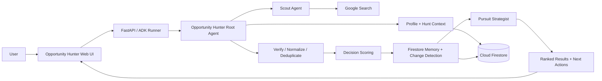

# Opportunity Hunter

**Turn scattered opportunity discovery into a prioritized action portfolio.**

Opportunity Hunter is an AI workflow agent that **finds, qualifies, prioritizes, tracks, and advances high-fit opportunities** based on who the user is, what they can do, what they care about, and what they are trying to achieve.

**Live app:** https://opportunity-hunter-107621546882.us-central1.run.app/hunter

## Why This Exists

The problem is not a shortage of search results. It is follow-through.

High-value opportunities are fragmented across job boards, hackathon sites, scholarship pages, marketplaces, local listings, newsletters, professional networks, and other sources. A user can easily collect dozens of links and still not know:

- Is this current and legitimate?
- Am I actually eligible?
- How well does it fit me?
- Is the upside worth the effort?
- Have I seen it before?
- Did anything important change?
- What should I do next?

Search finds options. **Opportunity Hunter turns those options into decisions and next actions.**

## Core Workflow

**Find → Qualify → Prioritize → Track → Act**

1. **Find** — interpret a natural-language Hunt and search current sources.
2. **Qualify** — verify candidate-specific evidence, eligibility, status, and key facts.
3. **Prioritize** — score opportunities against the user's goals, capabilities, constraints, and expected value.
4. **Track** — use persistent memory to distinguish NEW, CHANGED, and UNCHANGED opportunities.
5. **Act** — generate a practical pursuit plan for the strongest opportunities.

The result is not another search list. It is a managed opportunity portfolio.

## Example Hunts

Users can enter ordinary-language requests such as:

- “Find AI hackathons I can still enter.”
- “Find consulting opportunities that fit healthcare transformation experience.”
- “Scholarships for a high school student interested in music and science.”
- “Find sports-card estate sales within 25 miles.”

A Hunt can also include personal context such as skills, goals, interests, preferences, constraints, geography, and time availability.

## What Makes It Different

### 1. Personal fit, not generic relevance

Opportunity Hunter uses a persistent user profile rather than evaluating every opportunity as if all users were interchangeable.

### 2. Structured decision scoring

Each opportunity is evaluated using a deterministic weighted framework:

- Strategic fit — 30%
- Capability fit — 25%
- Expected value — 20%
- Probability of success — 15%
- Effort efficiency — 10%

Recommendations are:

- **PURSUE** — 80+
- **CONSIDER** — 65–79
- **PASS** — below 65

### 3. Source discipline

High-confidence recommendations require candidate-specific evidence. Generic homepages, directories, category pages, and search-result pages are not enough when an exact opportunity page should exist.

If the evidence cannot be verified, the system lowers confidence instead of inventing certainty.

### 4. Persistent memory

Cloud Firestore stores Hunts and prior evaluations so Opportunity Hunter can identify whether an opportunity is:

- **NEW**
- **CHANGED**
- **UNCHANGED**

This prevents repeated searches from becoming repeated work.

### 5. Pursuit strategy

For strong opportunities, a specialist agent produces:

- why the opportunity matters,
- urgency and timing,
- requirements,
- advantages and gaps,
- risks and tradeoffs,
- an immediate next action,
- a short pursuit plan.

The strategist receives the current date so it does not recommend planning phases that have already passed.

## User Experience

The public product includes:

- free-text Hunts,
- optional personal context,
- Saved Hunts,
- visible progress while the agent works,
- ranked results,
- scores and PURSUE / CONSIDER / PASS recommendations,
- verified source links,
- NEW / CHANGED state,
- expandable detailed analysis,
- Copy Results,
- Export CSV.

## Decision Tracking: “What changed since I last looked?”

A one-off AI search answers *what exists today*. Opportunity Hunter now also answers **what changed since I last looked, and does it change what I should do?**

1. **Save a decision.** From any Hunt result (or manually), record **Pursue / Watch / Pass**, a short reason, the official source URL and an optional evidence note. The current deadline, eligibility, participation format and submission requirements are captured from the official page as the baseline.
2. **Check for updates.** Rechecks the official source and compares it with the **last successful check** — field by field, prioritizing deadlines, eligibility, participation format and submission requirements.
3. **Review what matters.** Each result gets one status:

| Status | Meaning | In review queue? |
|---|---|---|
| **Reconsider** | A material change touches the reason you saved (e.g. you passed because travel was required; rules now allow remote) | Yes, first |
| **Changed** | A material change not tied to your reason, or one that makes a Pursue harder | Yes |
| **Couldn't verify** | Retrieval failed or evidence is ambiguous (wrong page, key terms vanished). Last verified evidence and your decision are preserved | Yes |
| **Wording only** | Copy edits with the same dates, obligations and format | No |
| **No change** | Matches the last verified evidence | No |

Opening a change shows before/after wording side by side, the source link, and an explanation tied to your saved reason. Your decision only changes when you confirm it.

The comparison engine (`app/recheck.py`) is deterministic and needs no API keys; the demo and live paths run through the same code.

### Run locally (no cloud credentials needed for tracking and the demo)

```bash
uv sync
OH_STORAGE=local uv run uvicorn app.fast_api_app:app --port 8000
```

Open http://localhost:8000/hunter. Discovery (Gemini + Google Search) still needs `gcloud auth application-default login`; without credentials the Discover tab explains this and the rest of the app works.

Storage: `OH_STORAGE=firestore` uses the project's Cloud Firestore (`tracked_opportunities` collection with a `checks` subcollection); `local` writes `.oh_state/tracker.json`; the default `auto` picks Firestore when credentials exist.

### 60-second demo (clearly labeled demo data)

On an empty Review screen, click **Run the 60-second demo**, then **Publish version 2 of the sources**, then **Check all for updates**. Three fictional listings (`data/demo/`) show:

- **Northstar Health AI Challenge** (Pass: “requires in-person travel”) → v2 allows remote → **Reconsider**, with before/after wording; confirm **Change to Pursue**.
- **Civic Data Fellowship** (Watch) → v2 rewords deadline and eligibility only → **Wording only**, stays out of the queue.
- **Open Climate Data Grant** (Pursue) → v2 source returns HTTP 503 → **Couldn't verify**; last verified evidence and the Pursue decision are kept.

Refresh the page: decisions, checks and history persist. See `docs/demo-60s.md` for a narrated script.

### Tests

```bash
uv run pytest tests/unit                       # engine, workflow, persistence, HTTP path, API
OH_LIVE_URL=https://www.nsf.gov/funding/opportunities/reu-research-experiences-undergraduates \
OH_LIVE_TITLE="Research Experiences for Undergraduates (REU)" \
uv run pytest tests/integration/test_live_source.py   # opt-in live official listing
```

## Architecture



See `docs/architecture.md` for additional detail.

## AI and Cloud Stack

Opportunity Hunter uses:

- **Google Agent Development Kit (ADK)** for agent orchestration
- **Gemini 3.6 Flash** on Vertex AI
- **Google Search** for current opportunity discovery
- **Cloud Firestore** for persistent state and memory
- **Cloud Run** for the hosted application
- **Cloud Build** for deployment
- **FastAPI**
- **Python / uv**

The model identifier used by the current agent implementation is defined in `app/agent.py`.

## Technical Flow

A representative run executes this sequence:

1. Load the user profile and Saved Hunt or interpret a free-text Hunt.
2. Scout current web sources.
3. Verify source quality and current/open status.
4. Normalize and deduplicate candidates.
5. Score each viable opportunity.
6. Record the evaluation in Firestore.
7. Compare against prior state to determine NEW / CHANGED / UNCHANGED.
8. Generate a Pursuit Plan for strong recommendations.
9. Return ranked results with evidence and next actions.

## Validation

The MVP has been tested with:

- strong-fit PURSUE cases,
- weak-fit PASS cases,
- hard eligibility failures,
- duplicate candidates,
- missing and unknown information,
- exact-source verification,
- NEW → UNCHANGED → CHANGED persistence,
- Saved Hunts,
- free-text Hunts,
- current-date pursuit planning,
- public Cloud Run execution.

A validated end-to-end flow is:

**UI → Hunt → Scout → Verify → Normalize/Dedupe → Score → Firestore Memory → Pursuit Strategist → Ranked Results**

## AI Builders Judging Fit

### Innovation & Creativity

Opportunity Hunter is a meta-agent for opportunity management: it does not stop at discovery, but converts opportunities into a continuously managed decision portfolio.

### Technical Implementation

The product combines multi-agent orchestration, live search, deterministic scoring, structured state, persistent memory, change detection, and a hosted UI in one working workflow.

### Problem Solving & Impact

It reduces the manual burden of repeatedly searching, validating, comparing, remembering, and planning around high-value opportunities.

### User Experience & Design

The interface hides the internal agent complexity behind a simple question: **“What should I hunt for?”** Users receive ranked, evidence-linked decisions rather than raw search output.

### Presentation & Feasibility

The application is publicly deployed, reproducible, and intentionally scoped as a usable MVP with clear paths to recurring automation and integrations.

## Repository Structure

- `app/agent.py` — agents, scoring, tools, and orchestration
- `app/fast_api_app.py` — FastAPI / ADK backend
- `app/hunter_ui.html` — web interface
- `app/memory_store.py` — Firestore persistence and change detection
- `app/recheck.py` — evidence extraction, comparison and decision-impact rules
- `app/tracker.py`, `app/tracker_store.py`, `app/tracker_api.py` — decisions, source checks, review queue, storage, routes
- `app/sources.py` — official-source retrieval (live HTTP or demo fixtures)
- `data/demo/` — demo fixtures (two versions of three fictional listings)
- `data/` — profile and state schemas
- `docs/architecture.md` — architecture diagram
- `tests/` — test scaffold
- `Dockerfile` — Cloud Run container
- `pyproject.toml` — dependencies

## Local Setup

Requirements:

- Python
- uv
- Google Cloud SDK
- Google Agents CLI
- Google Cloud project with Vertex AI access

Install the Agents CLI:

```bash
uv tool install google-agents-cli
```

Authenticate and select a project:

```bash
gcloud auth application-default login
gcloud config set project YOUR_PROJECT_ID
```

Install dependencies:

```bash
agents-cli install
```

Run locally:

```bash
agents-cli playground
```

## Deployment

Enable the required Google Cloud services, including Vertex AI, Cloud Run, Cloud Build, and Firestore.

Deploy with:

```bash
agents-cli deploy --project YOUR_PROJECT_ID --region us-central1
```

Current public deployment:

https://opportunity-hunter-107621546882.us-central1.run.app/hunter

## Reproducible Demo

1. Open the public application.
2. Run the saved **AI Competitions** Hunt or enter a free-text Hunt.
3. Watch the progress stages while the system searches and evaluates.
4. Review ranked opportunities, source links, scores, and recommendations.
5. Run the same Saved Hunt again to exercise persistent memory and NEW / CHANGED / UNCHANGED behavior.
6. Expand **Full analysis** to inspect the detailed assessment and pursuit-strategy output.

## MVP Boundaries

The current MVP intentionally does not include:

- authentication / multi-user accounts,
- automated recurring execution (source rechecks are on demand; no background scheduler yet),
- direct Google Sheets synchronization,
- email / Slack / calendar notifications,
- payments,
- continuous broad web indexing.

These are roadmap extensions rather than requirements for proving the core product loop.

## Roadmap

Natural extensions include:

- recurring automated Hunts,
- alerts only when high-value opportunities appear or materially change,
- résumé and public-profile ingestion,
- Google Sheets / Gmail / Calendar integrations,
- collaborative Hunts,
- learning from which opportunities users pursue, reject, or complete,
- portfolio analytics across opportunity types.

## Development Note

The current implementation was developed beginning August 24, 2026, within the AI Builders Hackathon build period that began August 21, 2026. It was also used as a submission in the Google Cloud All Things Agentic Hackathon. This AI Builders submission focuses on the product's broader SaaS/workflow value, usability, technical implementation, and real-world adoption potential.

## Product Principle

**Don’t give me more things to search. Give me the opportunities worth acting on.**
