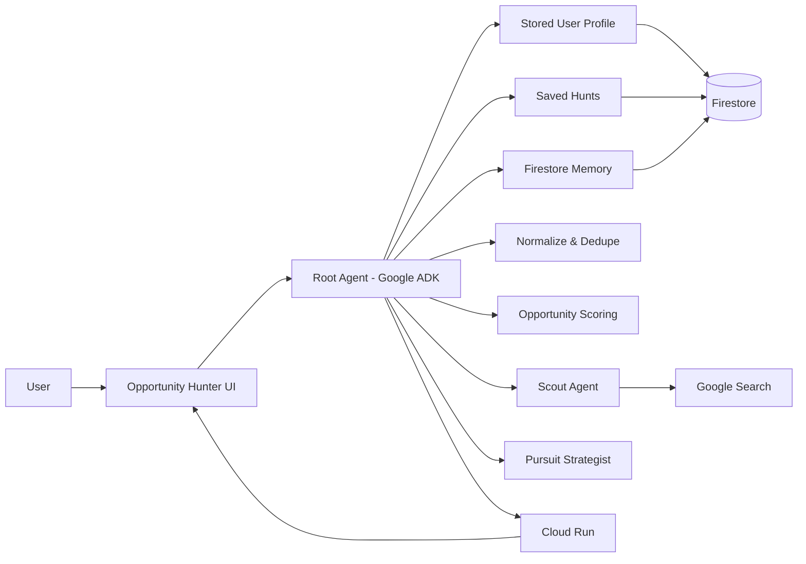

# Opportunity Hunter Architecture

## Flow

1. User profile defines goals, capabilities, interests, and constraints.
2. Saved Hunts define what Opportunity Hunter should search for.
3. Scout Agent discovers current opportunities from live sources.
4. Results are normalized and deduplicated.
5. Each opportunity is scored against the user profile.
6. Firestore tracks whether each result is NEW, CHANGED, or UNCHANGED.
7. Pursuit Strategist creates an action plan for strong opportunities.
8. The application runs on Google Cloud Run.
